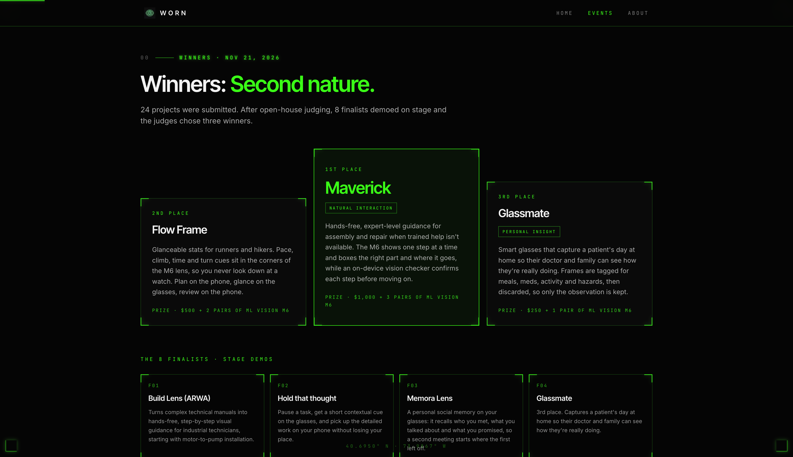
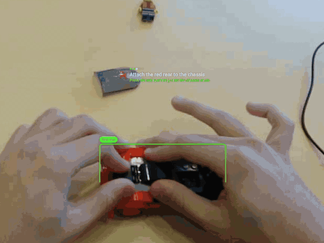

<p align="center">
  
</p>

# Maverick

**1st place, Worn hackathon (Nov 21, 2026).** 24 projects were submitted; after open-house judging, 8 finalists demoed on stage and the judges chose Maverick for first place in the *Natural interaction* track.

Hands-free, expert-level guidance for assembly and repair when trained help isn't available. Smart glasses show one step at a time, box the right part and where it goes, and a vision checker confirms each step before moving on. The wearer never taps to continue.

Built at the hackathon (Nov 20-21, 2026) on MicroLumin MLVision M6 glasses by five students from Columbia and NYU.

<p align="center">
  <a href="media/demo.mp4"></a>
  <br><sub>Click for the full demo video (67 s, with sound)</sub>
</p>

|  |  |
|---|---|
| **Demo** | [media/demo.mp4](media/demo.mp4) (67 s) |
| **Trailer** | [media/trailer.mp4](media/trailer.mp4) (32 s) |
| **Pitch deck** | [deck/maverick-deck.pdf](deck/maverick-deck.pdf) |

## What it does

- **One step at a time.** A short instruction on the lens, with the manual's drawing for the step.
- **AR boxes.** A box on the part to pick up, then on the spot where it goes, tracked on the glasses at camera rate.
- **Checks the work.** The camera verifies each step is done (and catches mistakes) before the next one appears.
- **Ask by voice.** Say "Maverick, where is the red rear?" and it answers from memory and points: a box, or an edge arrow if the part is out of view.
- **Teach it a new task from photos.** A few photos per part become a detector that runs on the glasses.

## Edge detection: models made for the glasses

The parts are found by a small detector we train ourselves, and we built the whole path from phone photos to a model that runs on the glasses' own processor (one Cortex-A75, 2 GB, no GPU):

1. **Photos to detector.** A few photos per part, auto-labelled, cut out with SAM and pasted onto hundreds of different surfaces; YOLO11n learns the part, not the table.
2. **Fit to the glasses.** Fine-tune at the glasses' input size, export to fixed-size ONNX, quantize to 8-bit using frames recorded on the glasses, keep the box head in floating point.
3. **Test bench.** `glasses_sim.py` replays a real recorded run through exactly the glasses' processing, predicts on-device latency from timings measured on the device, and simulates what the wearer would see at that latency.
4. **Hot swap.** The glasses download whichever model `meta.json` points at. No reinstall.

The same network on the glasses takes 900 to 1400 ms a look as exported, 244 ms after the pipeline, and 116 ms for our half-width variant. Full method and numbers: [docs/edge-detection.md](docs/edge-detection.md).

Detection runs on the Mac hub by default (about 23 ms a look) and on the glasses with one switch: "Find parts on the glasses" in the phone app or the display page's Settings.

## How it fits together

```
glasses (Android app)  ──frames / detections──▶  hub (FastAPI)  ──▶  Azure OpenAI
  lens HUD, box tracker,                          step state machine,   step checks,
  optional on-device detector  ◀──steps, boxes──  detector, memory,     voice, parsing
                                                  voice
                                                       ▲
                          phone app (setup, consent, controls)  ·  display page
```

| Folder | What's in it |
|---|---|
| `backend/` | Python + FastAPI hub: step state machine, part detector, step checker, part memory, voice. Training and export tools. |
| `glasses-app/` | Android app that runs on the glasses: camera, lens HUD, on-device box tracker, optional ONNX detector. |
| `phone-app/` | Android shell around the hub's `/app` page: setup, consent, fit, device controls. |
| `ui/` | The display page and the phone page (Vite, React, Tailwind, shadcn). Builds into `web/dist/`. |
| `guides/` | Step lists, and per kit the trained detector and the glasses models. |
| `styleguide/` | Colours, type and the lens HUD spec. |
| `docs/` | [Architecture](docs/architecture.md), [edge detection](docs/edge-detection.md), [glasses setup](docs/glasses-setup.md). |
| `media/`, `deck/` | Demo video, trailer, pitch deck. |

## Run it

Needs [uv](https://docs.astral.sh/uv/), Node 20+, and an Azure OpenAI resource. Copy `.env.example` to `.env` and fill it in; without keys the step checker runs in mock mode.

```sh
cd ui && npm install && npm run build && cd ..   # once: builds the display page
./run.sh          # hub on :8000, opens the display page
./device.sh       # installs the glasses app (or any Android phone) over USB
./phone.sh        # installs the phone app
./tether.sh &     # keeps the USB tunnels alive
```

Tests: `cd backend && uv run pytest -q`

No glasses? `./device.sh` on any Android phone behaves like a see-through lens, and http://localhost:8000/fake is a browser stand-in. For real glasses see [docs/glasses-setup.md](docs/glasses-setup.md).

## Team

Built by five students from Columbia and NYU: [@jordanmahmood](https://github.com/jordanmahmood), [@riccardogiovenzana04-dev](https://github.com/riccardogiovenzana04-dev), [@vidher-notaprogrammer](https://github.com/vidher-notaprogrammer), [@JL12345555](https://github.com/JL12345555) and [@ai2652-png](https://github.com/ai2652-png).

## Hardware and vendor SDK

The glasses are MicroLumin MLVision M6. The vendor's SDK and demo apps are confidential and are not included in this repository; the glasses app here talks to the glasses with plain Android and `adb`.
