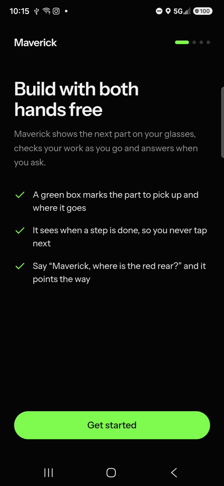
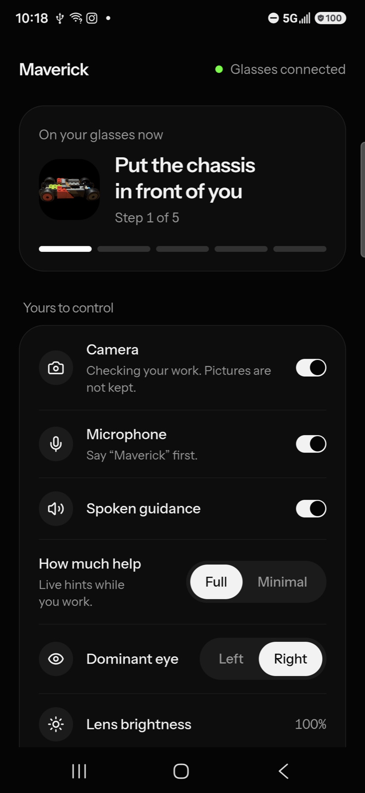
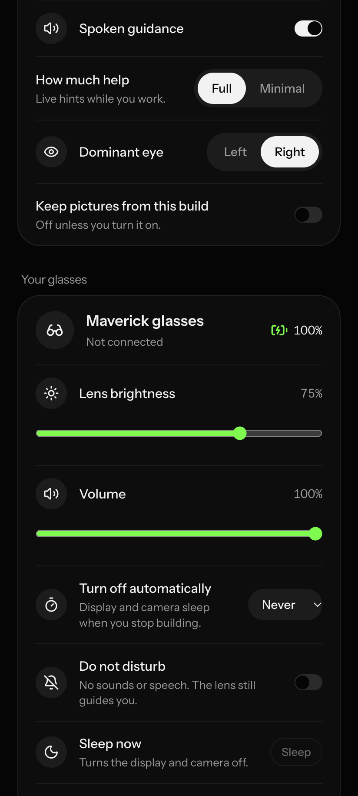
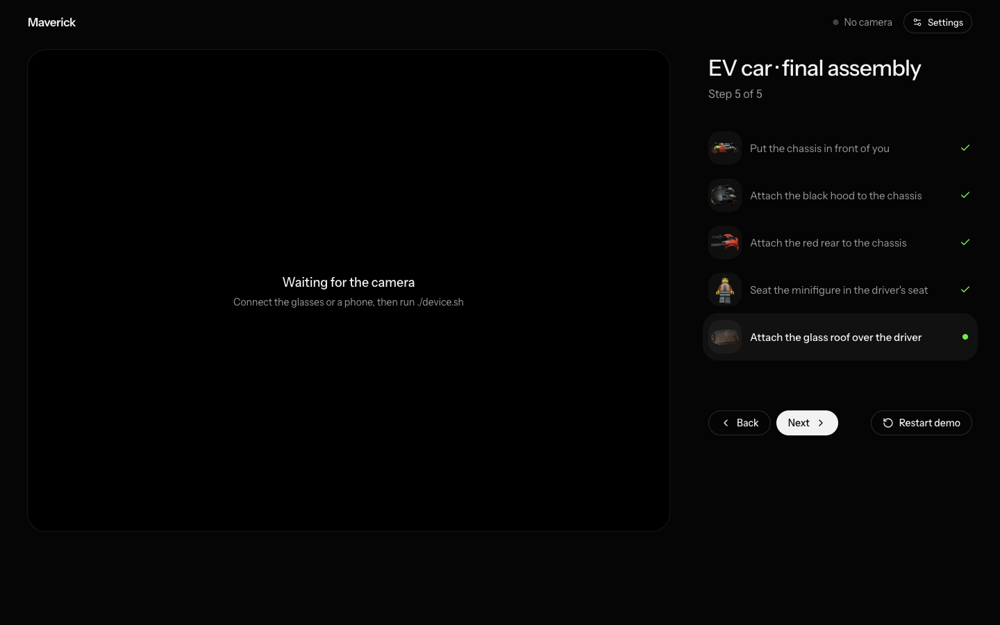
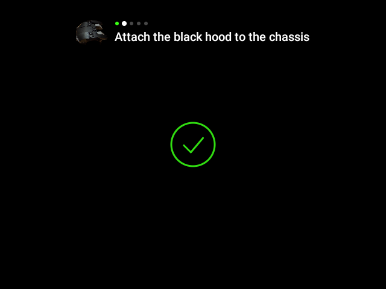
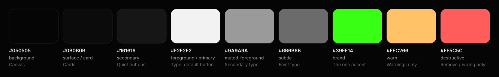
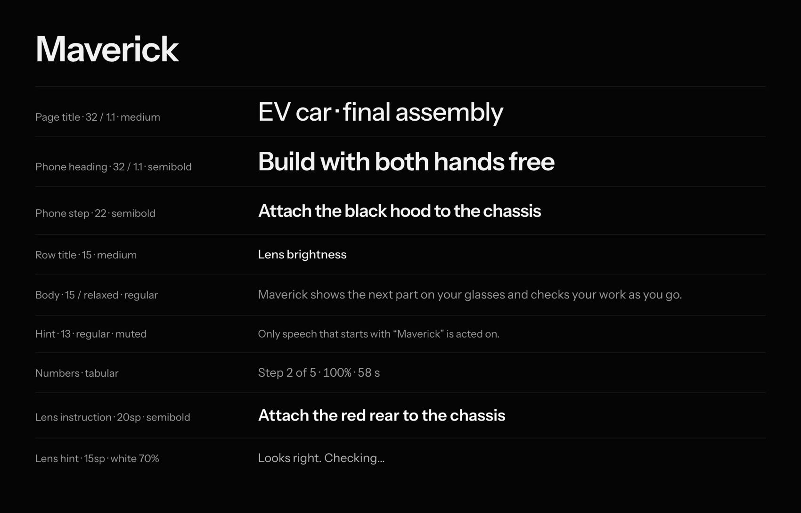
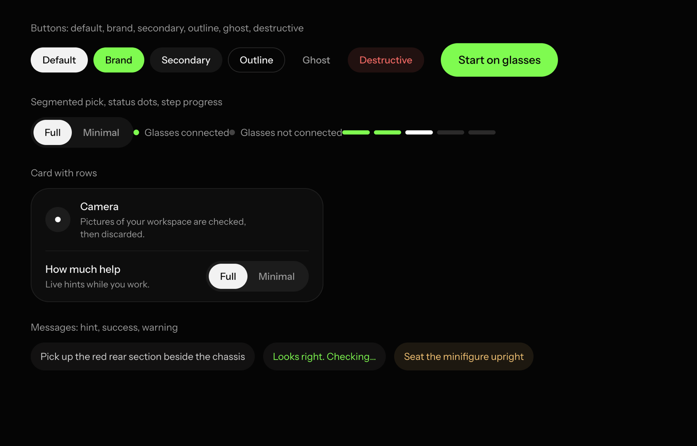

# Maverick style guide

Calm, near-black, one neon accent. Everything is written in sentence case and shows only what the wearer needs right now.

Every value here is copied from the code that ships: `ui/src/index.css`, `ui/src/phone.tsx`, `ui/src/components/`, `glasses-app/` and `phone-app/`. The tokens are in [`tokens.css`](tokens.css).

| Phone: setup | Phone: while building | Phone: glasses controls |
|---|---|---|
|  |  |  |
| First setup screen, captured on the phone. | Home screen during a build, captured on the phone. | "Yours to control" and "Your glasses", captured in a browser at phone size. |


*The display page at 1440 × 900, captured in a browser with no camera connected.*


*The lens, captured on the glasses (640 × 480). Black is transparent on the lens, so this is all the wearer sees over the real world.*

## Wordmark and icon

The wordmark is the word "Maverick" set in Instrument Sans semibold with tight tracking. No symbol beside it, no capitals beyond the M.

```css
.wordmark {
  font-family: "Instrument Sans Variable", ui-sans-serif, system-ui, sans-serif;
  font-weight: 600;
  letter-spacing: -0.025em;   /* Tailwind tracking-tight */
  color: #f2f2f2;
}
```

In the product it is `text-[17px] font-semibold tracking-tight` on the display page and `text-lg font-semibold tracking-tight` (18px) on the phone.


The app icon is a thin rounded square in the accent with a white M, on the near-black background ([`images/app-icon.svg`](images/app-icon.svg), same paths as `phone-app/app/src/main/res/drawable/ic_launcher_foreground.xml`):

```xml
<path d="M41,30 H67 A11,11 0 0 1 78,41 V67 A11,11 0 0 1 67,78 H41 A11,11 0 0 1 30,67 V41 A11,11 0 0 1 41,30 Z"
      fill="none" stroke="#39FF14" stroke-width="2.5"/>
<path d="M43,65 V44 L54,58 L65,44 V65"
      fill="none" stroke="#FFFFFF" stroke-width="4.5" stroke-linecap="round" stroke-linejoin="round"/>
```

## Colour



| Token | Hex | Used for |
|---|---|---|
| `--background` | `#050505` | The canvas, everywhere. Also the phone's system bars and the icon background. |
| `--surface` / `--card` | `#0b0b0b` | Solid cards. Most cards are `white 3%` over the canvas instead. |
| `--secondary` | `#161616` | Quiet buttons. |
| `--foreground` / `--primary` | `#f2f2f2` | Text, and the default button (white pill, black text). |
| `--muted-foreground` | `#9a9a9a` | Secondary text, hints, labels. |
| `--subtle` | `#6b6b6b` | Faint text. |
| `--brand` | `#39ff14` | The one accent: the Worn hackathon green. |
| `--warn` | `#ffc266` | Warnings only. |
| `--destructive` | `#ff5c5c` | "Remove this" and "wrong" only. |
| `--border` | `white 9%` | Card and button outlines. |
| `--line` | `white 6%` | Hairlines between rows. |

Rules:

- **One accent.** Green marks the thing to act on (the AR box, the primary button, the selected step) and success (the done tick, a finished step, "Looks right"). Nothing else is green.
- **Never green on large areas.** The only filled green shapes are the primary button and small pills and dots.
- **Amber is for warnings**, red is for "remove this" and a wrong part. Neither is ever decoration.
- **Text on green is `#050505`**, never white.
- **Translucent whites do the rest:** `white/[0.03]` card fill, `white/[0.06]` icon wells and segmented tracks, `white/15` outline buttons, `white/25` an idle status dot.

## Type



One family: **Instrument Sans** (variable, self-hosted through `@fontsource-variable/instrument-sans`). Weights 400, 500 and 600. Headings get `letter-spacing: -0.025em`. Numbers that change in place use tabular figures (`.num`). The lens uses the glasses' system sans at weight 600, because the glasses app is native.

| Where | Size | Weight |
|---|---|---|
| Display page title | 32px, line height 1.1 | 500 |
| Display page step list | 15px | 500 current, 400 others |
| Phone setup heading | 32px, line height 1.1 | 600 |
| Phone current step | 22px | 600 |
| Phone row title | 15px | 500 |
| Phone body | 15px, relaxed leading | 400, muted |
| Phone hint | 13px | 400, muted |
| Section label | 14px | 400, muted, sentence case |
| Lens instruction | 20sp, 2 lines at most | 600, white |
| Lens hint | 15sp, 1 line | 400, white 70% |
| Lens full-screen message | 26sp over 15sp | 600 over 400 |
| AR label pill | 14sp | 600 |

## Shape and spacing

- **Base radius 12px** (`--radius: 0.75rem`).
- **Pills:** every button, segmented control, status chip and AR label is fully rounded.
- **Cards:** `rounded-3xl` (about 26px), hairline border, almost no fill, 20px side padding, rows divided by a hairline.
- **Icon wells:** 36px circle, `white/[0.06]`, 18px Lucide icon.
- **Page gutters:** 20–24px on the phone, 24–40px on the display page; sections are 28px apart.
- **Icons:** Lucide, outline style, 16–20px.

## Components


*Rendered in a browser from the real classes; the text is sample text.*

### Buttons (`ui/src/components/ui/button.tsx`)

```ts
const buttonVariants = cva(
  "inline-flex shrink-0 items-center justify-center gap-2 rounded-full border border-transparent text-sm font-medium whitespace-nowrap transition-[background-color,color,border-color,opacity,transform] duration-150 active:scale-[0.985] disabled:opacity-40",
  {
    variants: {
      variant: {
        default: "bg-primary text-primary-foreground hover:bg-white/85",
        brand: "bg-brand text-brand-foreground hover:bg-brand/85",
        secondary: "bg-secondary text-secondary-foreground hover:bg-[#1f1f1f]",
        outline: "border-white/15 bg-transparent text-foreground hover:border-white/30 hover:bg-white/[0.04]",
        ghost: "text-muted-foreground hover:bg-white/[0.06] hover:text-foreground",
        destructive: "bg-destructive/12 text-destructive hover:bg-destructive/20",
      },
      size: {
        default: "h-9 px-4",
        sm: "h-8 px-3 text-[13px]",
        lg: "h-11 px-5 text-[15px]",
        xl: "h-12 px-6 text-base",
      },
    },
  },
)
```

One `brand` button per screen at most, for the step that moves things forward ("Get started", "Start on glasses"). Everything else is `default`, `outline` or `ghost`.

### Card and row (`ui/src/phone.tsx`)

```tsx
function Card({ children, className }) {
  return <section className={cn("rounded-3xl border border-white/[0.08] bg-white/[0.03] px-5", className)}>{children}</section>
}

function Row({ icon, title, hint, children }) {
  return (
    <div className="flex items-center gap-3.5 py-3.5">
      {icon && <span className="grid size-9 shrink-0 place-items-center rounded-full bg-white/[0.06] text-foreground [&_svg]:size-[18px]">{icon}</span>}
      <div className="min-w-0 flex-1">
        <p className="text-[15px] font-medium">{title}</p>
        {hint && <p className="mt-0.5 text-[13px] leading-snug text-muted-foreground">{hint}</p>}
      </div>
      {children}
    </div>
  )
}

// A card of rows: <Card className="divide-y divide-white/[0.06]"> … </Card>
```

### Segmented pick

```tsx
<div className="flex rounded-full bg-white/[0.06] p-1">
  {options.map(([id, label]) => (
    <button
      key={id}
      className={cn(
        "h-9 rounded-full px-4 text-sm font-medium transition-colors",
        value === id ? "bg-primary text-primary-foreground" : "text-muted-foreground",
      )}
    >
      {label}
    </button>
  ))}
</div>
```

The selected option is white, not green.

### Slider

```tsx
<div className="py-3.5">
  <div className="flex items-center gap-3.5">
    <span className="grid size-9 shrink-0 place-items-center rounded-full bg-white/[0.06] [&_svg]:size-[18px]">{icon}</span>
    <p className="flex-1 text-[15px] font-medium">{title}</p>
    <span className="num text-sm text-muted-foreground">{value}%</span>
  </div>
  <input type="range" min={min} max={100} step={5} value={value} className="mt-3 h-8 w-full accent-[#39ff14]" />
</div>
```

### Status dot

```tsx
<span className="flex items-center gap-2 text-sm text-muted-foreground">
  <span className={cn("size-2 rounded-full", on ? "bg-brand" : "bg-white/25")} />
  {on ? "Glasses connected" : "Glasses not connected"}
</span>
```

On the display page the live dot also breathes: `animate-pulse-dot` (2 s, opacity 1 to 0.35).

### Step progress

```tsx
{/* Phone: one bar per step */}
<div className="mt-5 flex gap-1.5">
  {steps.map((_, i) => (
    <span key={i} className={cn("h-1.5 flex-1 rounded-full",
      finished || i < index ? "bg-brand" : i === index ? "bg-white" : "bg-white/15")} />
  ))}
</div>

{/* Setup pages: the current page is a short green bar, the rest are dots */}
<span className={cn("h-1.5 rounded-full transition-all",
  i === page ? "w-6 bg-brand" : i < page ? "w-1.5 bg-white/60" : "w-1.5 bg-white/20")} />
```

Done is green, current is white, upcoming is faint white. The same rule holds on the lens.

### Messages

```tsx
<p className="rounded-2xl bg-white/[0.05] px-3.5 py-2.5 text-sm text-foreground/85">{hint}</p>   {/* neutral */}
<p className="rounded-2xl bg-white/[0.05] px-3.5 py-2.5 text-sm text-brand">{hint}</p>           {/* going well */}
<p className="rounded-2xl bg-warn/10 px-3.5 py-2.5 text-sm text-warn">{warning}</p>              {/* warning */}
```

## The lens

The lens is a 640 × 480 see-through display. **Black is transparent**, so the HUD is drawn on pure black with no panels or backgrounds, and anything bright is something the wearer has to look through.

- **Keep it clear.** One instruction bar and, at most, one or two boxes. Pictures appear briefly and go away.
- **The bar sits at the top**, centred, 14dp from the edge, between 46% and 88% of the lens wide.
- **Contents of the bar:** the part's picture (52dp), then step dots, the instruction (20sp semibold white, two lines at most) and one hint line (15sp, white 70%).
- **Hint colour:** white 70% normally, green when it is going well, amber for a warning. A warning also turns the instruction amber.
- **Step dots:** 6dp, 12dp apart; done is green, current is white and 8dp, upcoming is white 28%.
- **Full-screen messages** ("All done", "Finish setup on your phone") are centred: 26sp semibold over 15sp.

The same bar on the display page, in container-width units so it matches the lens at any size (`ui/src/components/live-view.tsx`):

```tsx
<div className="absolute top-[2.2cqw] left-1/2 flex max-w-[88%] min-w-[46%] -translate-x-1/2 items-center gap-[1.9cqw] rounded-[2.8cqw] p-[2.2cqw]">
  
  <div className="min-w-0">
    <div className="mb-[1.1cqw] flex items-center gap-[0.95cqw]">
      {dots.map((_, i) => (
        <span className={cn("rounded-full",
          i + 1 < current && "size-[0.95cqw] bg-brand",
          i + 1 === current && "size-[1.25cqw] bg-white",
          i + 1 > current && "size-[0.95cqw] bg-white/30")} />
      ))}
    </div>
    <p className={cn("text-[3.125cqw] leading-[1.15] font-semibold", screen.warn ? "text-warn" : "text-white")}>{screen.big}</p>
    <p className="mt-[0.6cqw] truncate text-[2.34cqw] text-white/70">{line}</p>
  </div>
</div>
```

### AR box

A thin rounded outline with a soft glow and a pill label. `u` is one lens pixel.

```ts
const colour = target.style === "remove" ? "#ff5c5c" : "#39ff14"
const place = target.style === "place"
const pulse = place ? 0.825 + 0.175 * Math.sin((time / 1200) * Math.PI * 2) : 1   // "place" breathes

g.strokeStyle = colour
if (place) g.setLineDash([10 * u, 7 * u])       // "attach here" is dashed
g.globalAlpha = fade * pulse * 0.22             // glow
g.lineWidth = 7 * u
roundedRect(g, x, y, w, h, 10 * u); g.stroke()
g.globalAlpha = fade * pulse                    // the line itself
g.lineWidth = 2.5 * u
roundedRect(g, x, y, w, h, 10 * u); g.stroke()

// Label pill, 6u above the box (below it if there is no room): 14u semibold, 22u tall, fully rounded.
// "pick": filled with the colour, text #050505.  "place": outlined 1.5u, text in the colour.
```

| Box | Meaning | Look |
|---|---|---|
| Pick | The part to pick up | Solid green line, filled green pill with black text |
| Place | Where it goes | Dashed green line that breathes, outlined pill with green text |
| Remove | Something that does not belong | As "pick", in red |

When the thing is outside the view, a small green chevron on the nearest edge points toward it, with the same pill.

## Motion

Quick and quiet. Nothing bounces, nothing loops except "live" and "listening".

| What | Timing |
|---|---|
| Step done | Ring draws in 300 ms, tick draws in 200 ms, holds 250 ms, fades in 200 ms (950 ms in all). Ring is 72dp across with a 3dp line. |
| Wrong | The same in red, with an X in place of the tick. |
| Easing | `cubic-bezier(0.2, 0, 0, 1)` |
| "Attach here" box | Breathes between 65% and 100% opacity every 1.2 s |
| AR boxes | Glide toward each new position (50 ms time constant); appear and disappear over 150 ms |
| Pictures on the lens | Fade in 150 ms, out 250 ms; on the page they rise 6px over 320 ms |
| Live status dot | 2 s pulse, opacity 1 to 0.35 |
| "Listening…" pill on the lens | Green on black, opacity 100% to 60% and back in 800 ms |
| Buttons | 150 ms colour change; pressed scales to 0.985 |

`prefers-reduced-motion` turns all of it off on the page.

## Voice and copy

- **Sentence case everywhere.** No all-caps labels, no small-caps eyebrows, no title case. Section labels are quiet grey sentences: "Yours to control", "Your glasses", "What Maverick noticed".
- **Instructions are short and imperative, eight words or fewer:** verb, part, place.
- **Name parts by what the wearer sees:** colour and shape ("the black hood", "the red rear"), never a part number.
- **Say what is happening, plainly.** "Looks right. Checking…", "Camera paused", "Continue on your glasses".
- **Directions are concrete:** "to your right", not "nearby".
- **Be honest about data in one line:** "Pictures of your workspace are checked, then discarded."
- **Maverick speaks only when spoken to**, by name: "Maverick, where is the red rear?" Spoken lines are the same short sentences shown on the lens.

Real copy from the product:

| Place | Text |
|---|---|
| Lens, step 2 | Attach the black hood to the chassis |
| Lens, step 4 | Seat the minifigure in the driver's seat |
| Lens, hint | Looks right. Checking… |
| Lens, finished | All done |
| Spoken, finished | All done. Nice build. |
| Phone, setup heading | Build with both hands free |
| Phone, consent heading | You decide what Maverick sees |
| Phone, primary button | Start on glasses |
| Phone, handoff | Continue on your glasses |
| Phone, switch hint | Only speech that starts with "Maverick" is acted on. |

## Do and don't

**Do**

- Keep the canvas `#050505` and let type do the work.
- Use green once per view, for the thing to act on.
- Round everything that can be pressed into a pill.
- Write the way you would say it across a workbench.
- Show one thing on the lens at a time.

**Don't**

- Don't fill large areas with green, and don't put white text on it.
- Don't use amber or red for anything but a warning or "remove this".
- Don't write in all caps, add eyebrow labels, or use a monospace face for decoration.
- Don't add a second accent colour, gradients or drop shadows.
- Don't put panels or backgrounds on the lens: black is the only background there.
- Don't make the wearer read more than one line and a hint.
